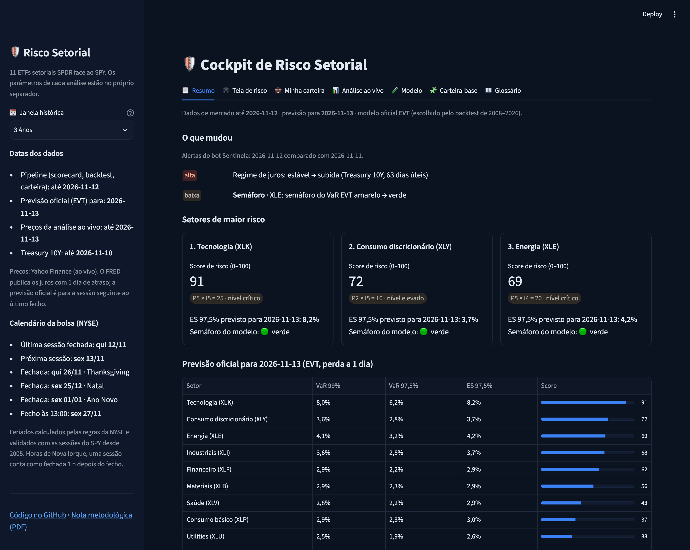
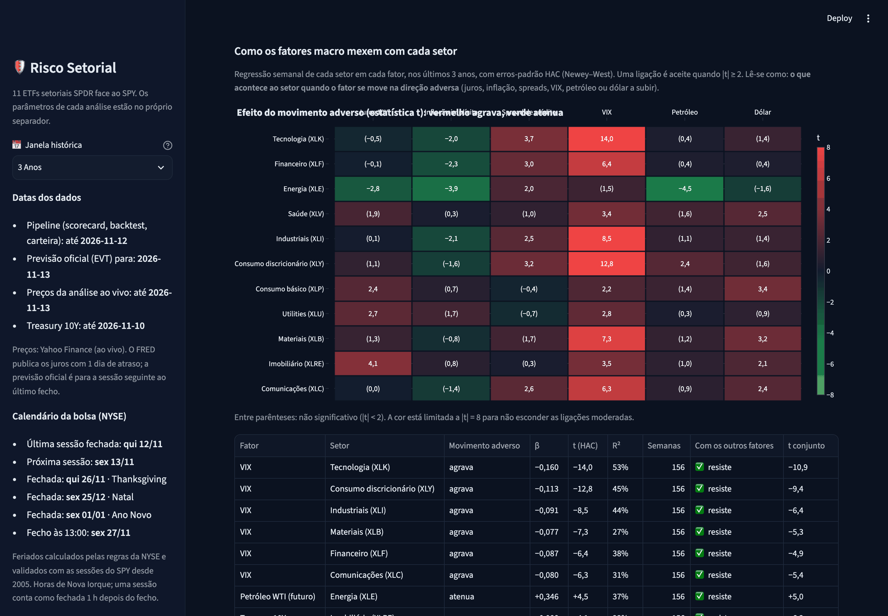
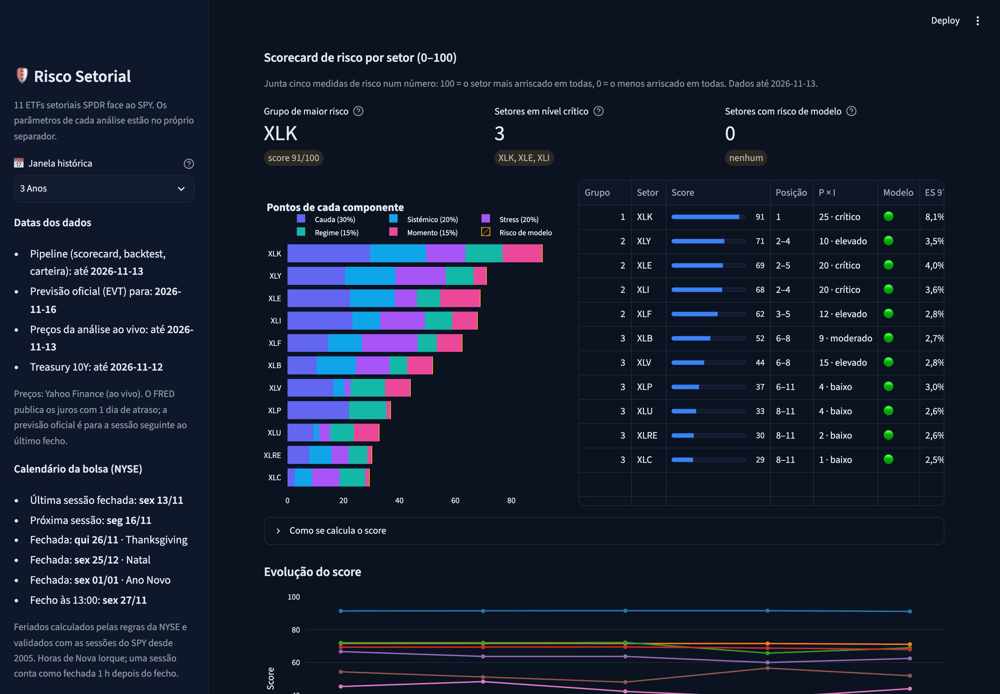
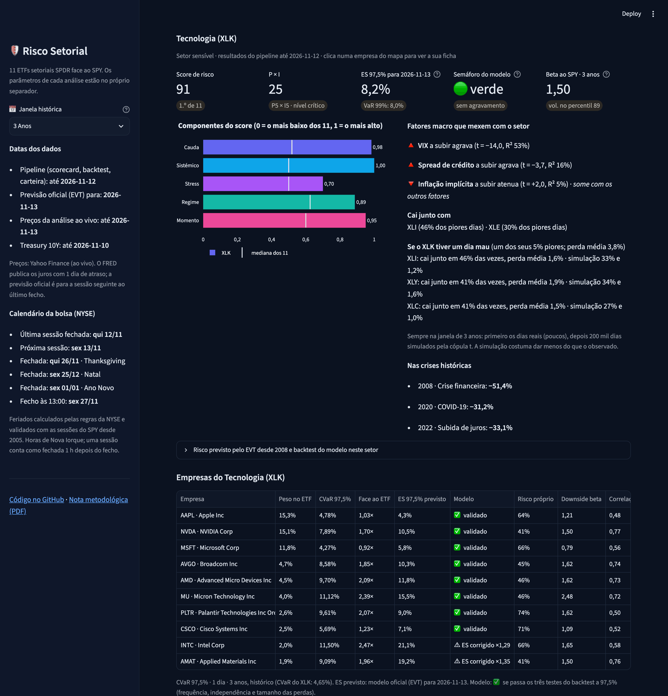
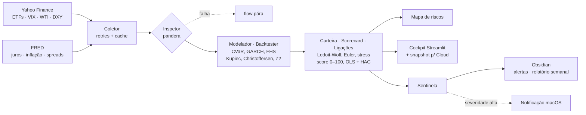

# Modelo de Risco Setorial

[](https://github.com/fernandoxb/sector-risk-model/actions/workflows/tests.yml)
[](https://sector-risk-model.streamlit.app)
[](LICENSE)

> **In English.** An end-to-end market-risk model for the 11 SPDR sector ETFs against the S&P 500. It is built as a
> portfolio project for a Master's in Risk Management. Daily VaR and Expected Shortfall come from three methods
> (historical, GJR-GARCH-t and Filtered Historical Simulation) and are **backtested out of sample from 2008 to 2026**
> with Kupiec, Christoffersen, Basel traffic lights and the Acerbi–Székely Z2 test. **Only the two methods that combine GARCH volatility with
> the empirical tail (FHS and conditional EVT) pass**; conditional EVT is chosen on 2008–2018 data, confirmed on
> 2019–2026 and on 109 single stocks, so it is the official model.
> The project also covers portfolio risk (Ledoit-Wolf covariance, Euler risk contributions, 2008/2020/2022 stress tests),
> a 0–100 risk scorecard, macro-factor → sector links estimated with HAC regressions, and an automated daily pipeline
> (Prefect + launchd) with alerts and weekly reports. There are 163 tests and CI on GitHub Actions.

Pipeline em Python que mede o risco de mercado dos 11 ETFs setoriais SPDR (XLK, XLF, XLE, XLV, XLI, XLY, XLP, XLU,
XLB, XLRE, XLC) face ao SPY, setor a setor e em carteira. Corre sozinho todos os dias úteis e publica os resultados em três
sítios:
* um **cockpit** Streamlit;
* um **mapa de riscos** interativo;
* notas no **Obsidian**, com alertas e um relatório semanal.

## Resultado principal: só os métodos com GARCH e cauda dos dados passam o backtest
VaR e ES a 1 dia previstos **só com dados até à véspera**, em janela móvel de 3 anos, de 2008 a 2026: 46 075 previsões
por nível, nos 11 setores. A tabela mostra em quantos setores (de 11) cada método **não é rejeitado** a 5%:

| Método | Kupiec 97,5% | Christoffersen 97,5% | Condicional 97,5% | Z2 (ES) 97,5% | Kupiec 99% | Christoffersen 99% | Condicional 99% | Z2 (ES) 99% |
|---|---|---|---|---|---|---|---|---|
| **GARCH-EVT** (oficial) | **11** | **9** | **11** | **11** | **11** | **8** | **9** | **10** |
| GARCH-FHS | 11 | 10 | 10 | 9 | 10 | 8 | 8 | 10 |
| GJR-GARCH(1,1)-t | 1 | 10 | 2 | 0 | 1 | 11 | 1 | 0 |
| Histórico | 7 | 1 | 1 | 3 | 5 | 1 | 1 | 2 |

Cada método falha por uma razão diferente:
* **Histórico:** acerta mais ou menos na frequência das exceções, mas reage tarde às crises e as exceções aparecem em grupos, por isso falha no Christoffersen.
* **GARCH com t-Student:** acompanha a volatilidade, mas a cauda paramétrica é demasiado fina, por isso falha no Kupiec e no Z2.
* **FHS e EVT:** juntam a volatilidade do GARCH à cauda dos resíduos passados. A FHS usa os resíduos tal como são; a EVT ajusta-lhes uma distribuição de Pareto na cauda (McNeil e Frey, 2000), o que estabiliza os quantis extremos.

**A escolha não depende dos dados em que foi avaliada.** O método é escolhido só com as previsões de 2008–2018 e
confirmado com as de 2019–2026, que a escolha nunca viu. Setores que passam os três testes (Kupiec, Christoffersen e
Z2) a 97,5%:

| Método | Escolha 2008–2018 | Confirmação 2019–2026 | Empresas (de 109) |
|---|---|---|---|
| **GARCH-EVT** | **9 de 9** | **10 de 11** | **75** |
| GARCH-FHS | 6 de 9 | 9 de 11 | 61 |
| GJR-GARCH(1,1)-t | 0 de 9 | 0 de 11 | 22 |
| Histórico | 0 de 9 | 3 de 11 | 21 |

Na amostra toda, a EVT e a FHS empatam nos setores (9 de 11); a EVT ganha nos dois períodos em separado e nas empresas.
Com a correção de Holm para os 88 testes de cada método, a EVT e a FHS ficam sem nenhuma rejeição (GARCH-t: 23;
histórico: 40).

Por isso é o **modelo oficial** e publica todos os dias o VaR 99%, o VaR 97,5% e o ES 97,5% da sessão seguinte (calendário da NYSE com feriados).


**E empresa a empresa?** O mesmo backtest corre nas 109 maiores empresas dos 11 setores (previsões desde 2018). A EVT
passa os três testes a 97,5% em **75 de 109** (FHS: 61; GARCH-t: 22; histórico: 21), e em 25 o ES ainda fica
subestimado: uma ação isolada tem saltos que um setor dilui. Nessas 25, o ES mostrado é corrigido pelo fator que teria
acertado no backtest (k = 1 − Z2, em média ×1,30).

## O que o projeto faz
| Bloco | Métodos | Onde |
|---|---|---|
| Risco de cauda | CVaR/ES 97,5% (FRTB), downside beta nos 20% piores dias do SPY | `src/models/cockpit.py`, `risk_metrics.py` |
| Previsão e backtest | Histórico, GJR-GARCH(1,1)-t, FHS e EVT condicional; Kupiec, Christoffersen, Z2 de Acerbi–Székely (p-valor por simulação), semáforo de Basileia, regra por mesa do FRTB | `src/models/backtest.py` |
| Empresas e carteira própria | O mesmo backtest em 109 empresas; carteira do utilizador com contribuições de Euler, exposição por setor, stress e previsão FHS | `src/models/backtest_empresas.py`, `carteira.py` |
| Carteira | Covariância de Ledoit-Wolf, contribuições de Euler para a volatilidade e o CVaR, stress tests de 2008, COVID-19 e 2022 | `src/models/portfolio.py` |
| Scorecard 0–100 | 5 componentes normalizados por percentil, multiplicador de risco de modelo (semáforo), P × I, sensibilidade ±50% aos pesos | `src/models/scorecard.py` |
| Dependência de cauda | Quedas conjuntas observadas e cópula t (tau de Kendall, ν por máxima verosimilhança) nos resíduos do GARCH; é o que liga o mapa de risco | `src/models/cauda.py` |
| Fatores macro | Regressões semanais setor ~ fator com erros HAC de Newey–West, para juros, inflação, spreads high yield, VIX, petróleo e dólar; contágio pela MST | `src/models/factor_links.py` |
| Bots | Prefect (uma task por bot), launchd nos dias úteis às 22:30, alertas do Sentinela e relatório semanal no Obsidian | `flows/`, `src/report/` |

| Mapa de riscos (setor selecionado) | Mapa de riscos (cadeia de impacto dos juros) |
|---|---|
|  |  |

O cockpit está organizado em separadores:
* **Resumo:** alertas do dia, setores de maior risco e previsão oficial para amanhã.
* **Mapa de risco:** a rede de contágio entre setores, ligados pelas quedas conjuntas (dependência de cauda) e não só pela correlação. Clicar num setor abre a ficha do setor (score, fatores macro, crises, risco previsto desde 2008) e as suas 10 maiores empresas; clicar numa empresa abre a ficha com dados de bolsa, risco e últimas notícias.
* **Minha carteira:** monta uma carteira com as 110 empresas, os ETFs e o SPY; mostra o risco histórico e o previsto (FHS), quem mais pesa nele, a exposição por setor no mapa de contágio e o stress. Guarda-se no link, sem conta.
* **Setores:** scorecard e evolução do score.
* **Análise ao vivo:** CVaR histórico, downside beta, regime de juros e exportação para o Obsidian.
* **Fatores macro.**
* **Modelo:** backtest.
* **Carteira-base:** a carteira de referência dos 11 setores, com contribuições para o risco, stress históricos e um cenário de stress próprio.
* **Glossário.**

| Resumo | Fatores macro |
|---|---|
|  |  |

| Mapa de risco: quem cai com quem |
|---|
|  |

| Mapa de risco (setor aberto) | Ficha da empresa |
|---|---|
|  |  |

| Minha carteira |
|---|
|  |

| Scorecard | Setor aberto no mapa |
|---|---|
|  |  |

**Outros números (dados até 2026-11-10):**
* **Carteira com pesos iguais:** volatilidade de 12,1% e CVaR 97,5% de 2,21% a 1 dia. A diversificação vale 1,49× na volatilidade, mas só 1,39× no CVaR, porque nas quedas os setores caem juntos.
* **Stress 2008:** a carteira perde 49,5% (SPY: 55,2%). Na COVID-19 perde mais do que o SPY (36,0% contra 33,7%), por causa do peso da energia.
* **Fatores macro:** 34 das 66 ligações fator → setor são significativas (|t| ≥ 2 com HAC). As mais fortes são o VIX → XLK (t = −14,0) e os spreads high yield → XLI (t = −11,5).
* **Scorecard:** o XLK lidera (91/100). O XLE tem um agravamento de risco de modelo, porque o seu semáforo a 99% está amarelo.

## Arquitetura

Regras do código:
* **Parâmetros:** estão todos em `config/settings.py`, sem números mágicos noutros ficheiros.
* **Funções de cálculo:** são puras e cada uma é validada contra uma implementação independente: fórmulas à mão em numpy, `sklearn` para a Ledoit-Wolf e Newey–West à mão para o `statsmodels`.

## Como correr
```bash
git clone https://github.com/fernandoxb/sector-risk-model && cd sector-risk-model
python3.11 -m venv .venv && .venv/bin/pip install -r requirements.txt
.venv/bin/python run_pipeline.py            # coleta → validação → modelos → mapa (precisa de rede)
.venv/bin/streamlit run app/cockpit/app.py  # cockpit em http://localhost:8501
open app/risk-map/index.html                # mapa de riscos (sem servidor)
.venv/bin/python -m pytest                  # 163 testes, sem rede
```
* **Chave do FRED:** é opcional. Se definires `FRED_API_KEY` num `.env`, os dados vêm pela API; caso contrário usa-se o CSV público.
* **Sem rede:** `run_pipeline.py --offline` reutiliza os dados de `data/raw/`.

### Bots e agendamento (Prefect + launchd)
```bash
.venv/bin/python -m flows.pipeline              # run completo (com download)
.venv/bin/python -m flows.pipeline --offline    # sem download
.venv/bin/python -m flows.pipeline --semanal    # força o relatório semanal
sh flows/install_launchd.sh                     # agenda nos dias úteis às 22:30 (hora do Mac)
launchctl kickstart gui/$(id -u)/com.fernando.sectorrisk   # corre já, para testar
sh flows/install_launchd.sh --remover           # desinstala
```
* **Logs:** ficam em `logs/pipeline.log`.
* **Permissões no macOS:** como o repositório está em `~/Documents`, o macOS pode pedir autorização no primeiro run agendado. Se o log mostrar "Operation not permitted", dá acesso total ao disco ao `python` do `.venv` em Definições do Sistema → Privacidade e Segurança.
* **Obsidian:** o Sentinela escreve em `Risco Setorial/` do cofre (`OBSIDIAN_VAULT`). O `00 Painel.md` precisa do plugin Dataview.

### Cockpit no Streamlit Community Cloud
O cockpit tenta sempre os dados ao vivo. Se o Yahoo não responder (ou com `COCKPIT_SNAPSHOT=1`), lê o **snapshot versionado** em `app/cockpit/snapshot/`, com cerca de 2,7 MB: preços de 3 anos, juros e resultados do pipeline. O flow atualiza o snapshot em cada run e, na última sessão de cada semana, o bot Publicador faz commit e push só dessa pasta (`--publicar` força a publicação noutro dia). O Streamlit Cloud atualiza a app sozinho a cada push.

Para o publicar:
1. Em [share.streamlit.io](https://share.streamlit.io), entra com o GitHub e escolhe **Create app** → *Deploy a public app from GitHub*.
2. Preenche: repositório `fernandoxb/sector-risk-model`, branch `main`, ficheiro `app/cockpit/app.py`. Em *App URL* escreve `sector-risk-model`.
3. Em *Advanced settings*: Python **3.11**. Em *Secrets* escreve `COCKPIT_SNAPSHOT = "1"`.
4. Clica em **Deploy**. As dependências vêm de `app/cockpit/requirements.txt`, que é mais leve do que o `requirements.txt` da raiz.

## Metodologia
O documento completo, com as fórmulas de todos os testes e modelos, as validações e as referências, está em
[`docs/nota-metodologica.md`](docs/nota-metodologica.md), também disponível em [PDF](docs/nota-metodologica.pdf).

Convenções:
* **VaR, CVaR e beta:** retornos simples e perdas em número positivo.
* **Volatilidade e GARCH:** retornos logarítmicos.
* **Nível do ES:** 97,5%, como no FRTB.
* **Rótulos:** dizem sempre o nível e a janela, por exemplo "CVaR 97,5% · 1 dia · 3 anos".

## Limitações
* **Universo:** são só ETFs setoriais dos EUA e as suas 10 maiores empresas; o resultado não se generaliza a outros mercados.
* **Empresas:** o modelo oficial só está validado em 75 de 109 e subestima o ES em 25. O backtest das empresas começa em 2018, por isso não inclui 2008.
* **Carteira do utilizador:** a previsão usa o modelo oficial sobre os retornos da carteira com os pesos atuais. O backtest de cada carteira tem só cerca de 2 anos de previsões, sem nenhuma crise.
* **Correção do ES:** o fator é calibrado no mesmo backtest que o justifica; corrige o que o passado mostrou.
* **Dados:** os preços vêm do Yahoo Finance (ajustados, sem garantia de serviço). Há séries do FRED com 1 dia de atraso, e o spread high yield (ICE BofA) só está disponível no FRED para os últimos 3 anos.
* **Proxies em 2008:** o XLRE e o XLC ainda não existiam, por isso no stress de 2008 usam um proxy β × SPY com o β atual, que ignora o risco específico.
* **Modelo oficial (EVT):** a 97,5% tem ligeiramente mais exceções do que as esperadas no agregado (1 208 contra 1 152, ou seja, 2,62% contra 2,5%). Na amostra toda só passa os três testes em 9 de 11 setores a 97,5% e em 7 de 11 a 99%.
* **Ligações macro:** são regressões univariadas (não isolam efeitos conjuntos) e não há correção para testes múltiplos nas 66 regressões. Com |t| ≥ 2, é de esperar cerca de 3 falsos positivos.
* **Dependência de cauda:** cada frequência de quedas conjuntas assenta em cerca de 38 dias (erro de uns 8 pontos), numa janela de 3 anos sem crise sistémica.
* **Scorecard e P × I:** são relativos aos 11 setores (percentis e quintis). Um setor pode mudar de nível sem que o seu risco mude. Na média dos stress tests, ganhos compensam perdas (o XLE em 2022).
* **Âmbito:** é um projeto académico e não é aconselhamento de investimento.

## Estrutura
```
config/settings.py      todos os parâmetros
src/collect/            Coletor (Yahoo, FRED)
src/clean/              Inspetor (pandera) + relatório de qualidade
src/models/             métricas, backtest, carteira, scorecard, ligações macro
src/report/             mapa, snapshot, Sentinela, relatório semanal
flows/                  flow Prefect e agendamento launchd
app/risk-map/           mapa de riscos (HTML autónomo)
app/cockpit/            cockpit Streamlit: app.py (dados, barra lateral), paineis/ (um ficheiro por separador), snapshot/
scripts/                capturas de ecrã e PDF da nota metodológica (Chrome headless)
tests/                  163 testes (pytest), sem rede (inclui o cockpit em modo snapshot)
docs/                   nota metodológica (.md e .pdf) e capturas
```

Licença MIT.
