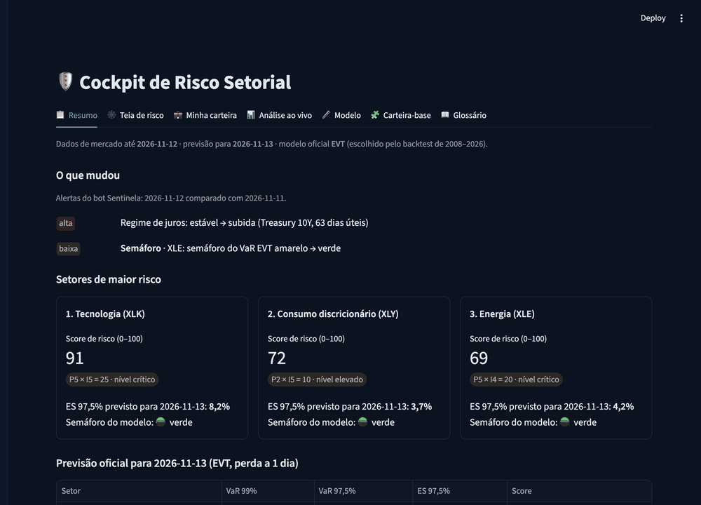
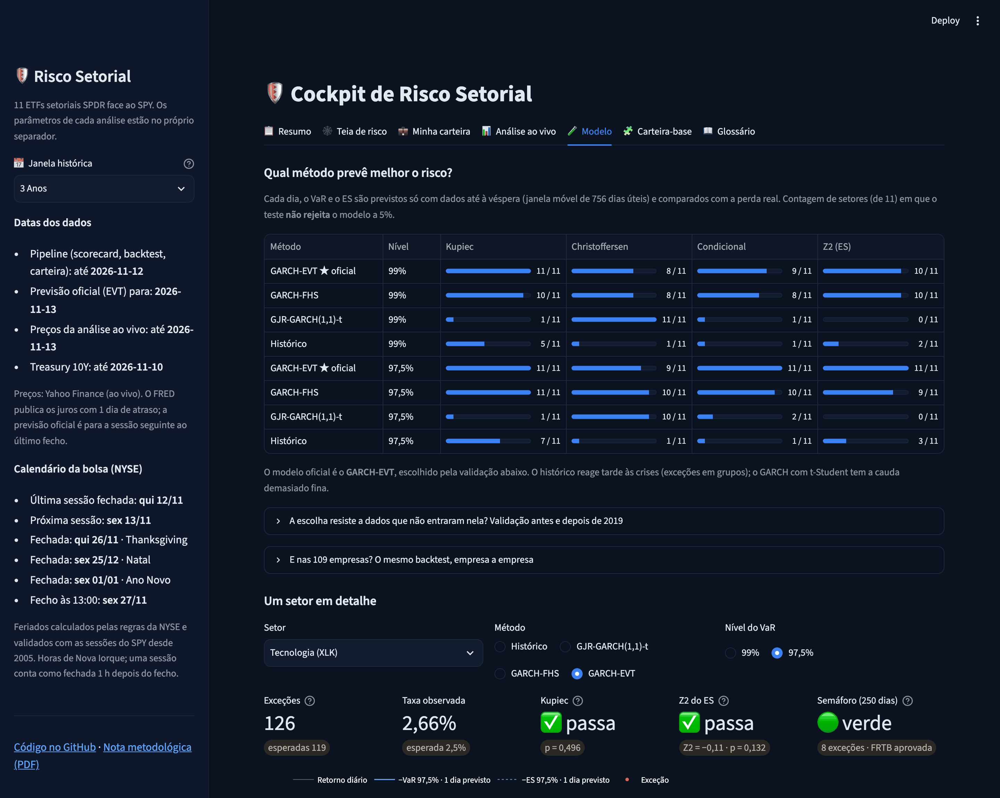
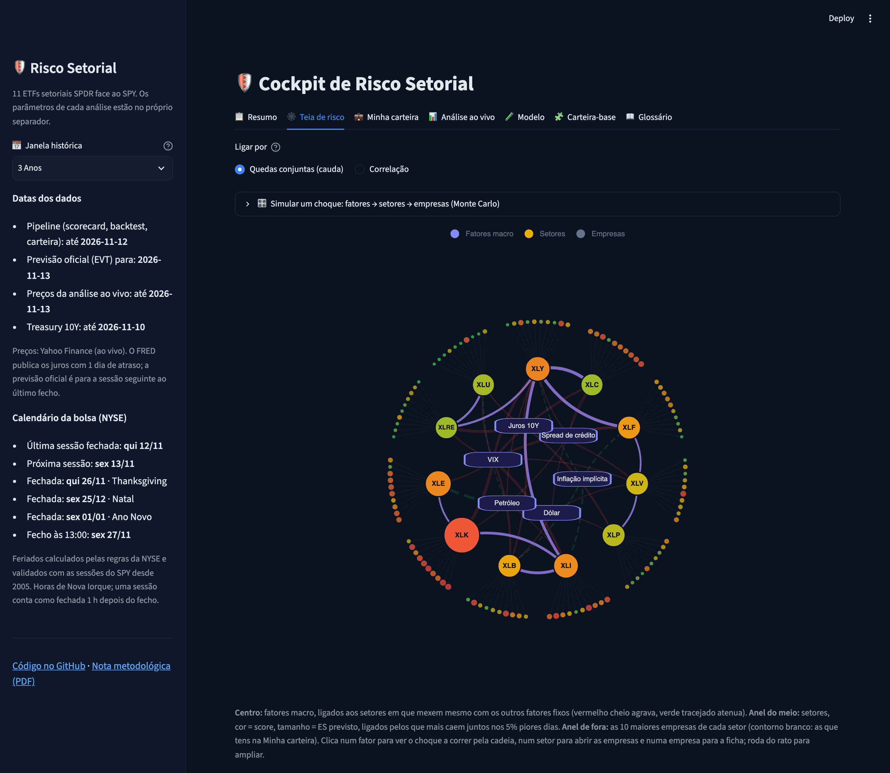
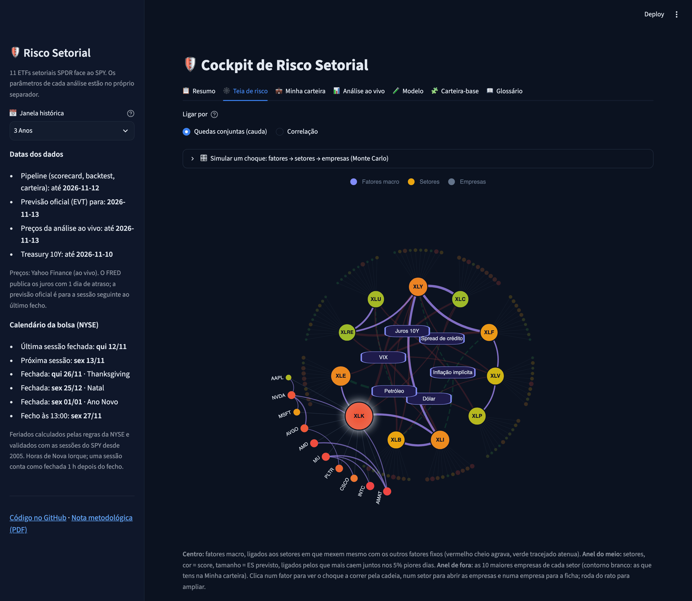
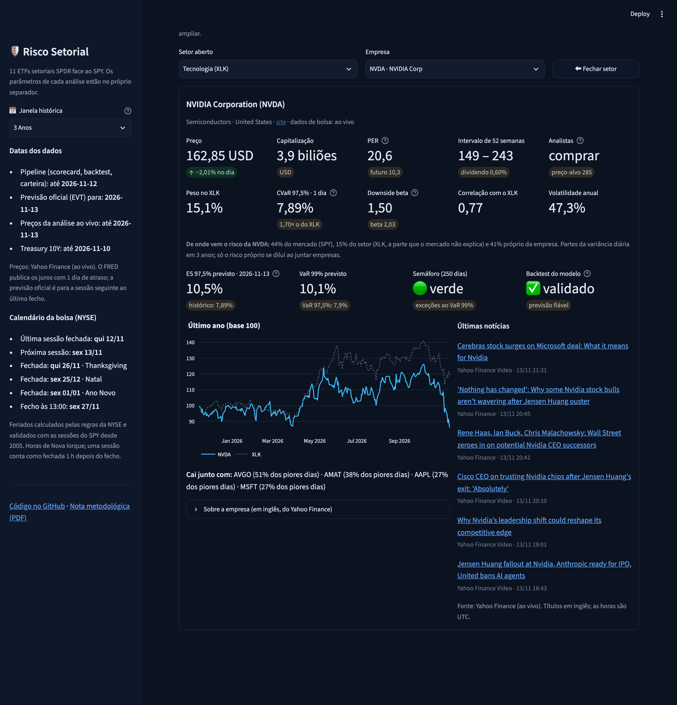
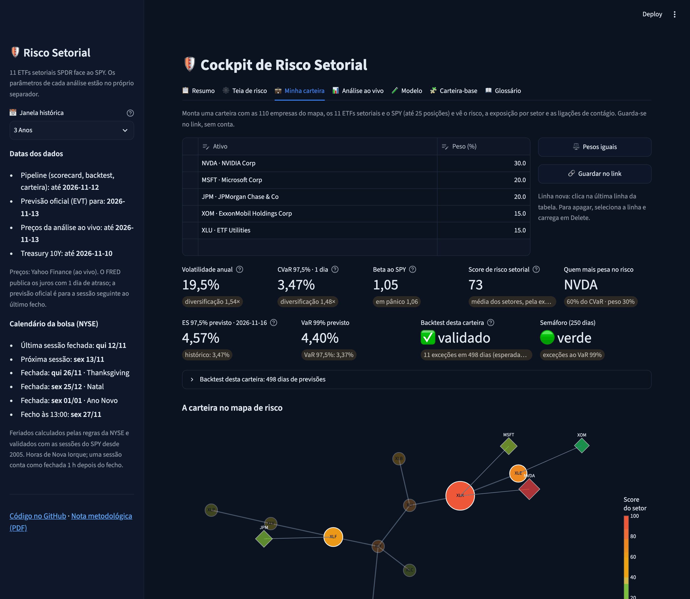

# Sector Risk Model

🇬🇧 English · 🇵🇹 [Português](README.pt.md)

[](https://github.com/fernandoxb/sector-risk-model/actions/workflows/tests.yml)
[](https://sector-risk-model.streamlit.app)
[](LICENSE)

An end-to-end market-risk system for the 11 SPDR sector ETFs and their 110 largest holdings, built as a portfolio project
for a Master's in Risk Management. It forecasts VaR and Expected Shortfall, **backtests them out of sample from 2008 to
2026**, measures which sectors and companies fall together, and propagates macro shocks from factors to sectors to single
stocks with a Monte Carlo engine. A scheduled pipeline refreshes everything every trading day.

**[Live cockpit](https://sector-risk-model.streamlit.app)** · [3-page summary (PDF)](docs/summary-en.pdf) ·
[full methodology, in Portuguese (PDF, 19 sections)](docs/nota-metodologica.pdf)



*The interface and the methodological note are in European Portuguese; the code is commented in Portuguese.*

## Results in 2 minutes

| Question | Answer |
|---|---|
| Which VaR/ES model survives the backtest? | Over ~46,000 forecasts per level (2008–2026), only the two methods that combine GARCH volatility with the empirical tail pass. Conditional EVT is chosen on 2008–2018 (9 of 9 sectors), confirmed on 2019–2026 (10 of 11) and on 76 of 109 single stocks. |
| Do sectors fall together? | More than correlation suggests: when consumer discretionary is in its 5% worst days, communication services is too on 54% of them (5% if independent). Sectors fall together more often than they rise together (27.9% against 24.2%). |
| What moves each sector? | 34 of 66 factor → sector links are significant one factor at a time; with all six factors in one regression, 28 survive and 12 vanish (rates → energy was really oil and inflation). |
| Where does a company's risk come from? | Median over 110 companies: 13% market, 21% sector, 56% its own. |
| What if a factor moves? | The scenario engine places sectors well when the market move is known (average error +0.5 pts in 2008, +3.5 pts in 2020); from macro factors alone it understates crises by about 15 pts. |
| And over 10 days? | 10-day VaR from simulated GARCH paths: 121 exceptions at 97.5% against 115 expected; the square-root-of-time rule does about as well on frequency (122). |

**What did not work, and is said so:** the ES is still underestimated in 17 of 109 companies (corrected by the factor that
would have been right in the backtest); the scenario engine's 90% intervals are **model intervals, not confidence
intervals** (in 2008, 2020 and 2022 the realised result fell inside them for 7 of 31 sector-crises from macro factors alone,
16 of 31 with the market move known, against about 28 expected), and the cockpit shows this coverage next to every result.

## Main result: only GARCH plus the empirical tail passes

Next-day VaR and ES forecast **with data up to the day before only**, on a rolling 3-year window, 2008–2026. Series passing
Kupiec, Christoffersen and the Acerbi–Székely Z2 test at 97.5%:

| Method | Choice, 2008–2018 | Confirmation, 2019–2026 | Companies (of 109, since 2008) |
|---|---|---|---|
| **GARCH-EVT** (official) | **9 of 9** | **10 of 11** | **76** |
| GARCH-FHS | 6 of 9 | 9 of 11 | 55 |
| GJR-GARCH(1,1)-t | 0 of 9 | 0 of 11 | 26 |
| Historical | 0 of 9 | 3 of 11 | 8 |

* **Historical simulation** gets the frequency roughly right but reacts late to crises: exceptions cluster, so it fails Christoffersen.
* **GARCH with Student-t** follows volatility, but its parametric tail is too thin: it fails Kupiec and Z2.
* **FHS and conditional EVT** combine GARCH volatility with the tail of past residuals (EVT fits a generalised Pareto to it; McNeil and Frey, 2000). With a Holm correction for the 88 tests per method, no EVT rejection survives.



## What the project does

| Block | Methods | Code |
|---|---|---|
| Tail risk | CVaR/ES 97.5% (FRTB), downside beta on the SPY's 20% worst days | `src/models/cockpit.py`, `risk_metrics.py` |
| Forecast and backtest | Historical, GJR-GARCH(1,1)-t, FHS, conditional EVT; Kupiec, Christoffersen, Z2 (simulated p-values), McNeil–Frey, Basel traffic lights, Holm; out-of-sample model choice | `src/models/backtest.py`, `backtest_empresas.py` |
| Horizons | 10- and 21-day VaR/ES by simulating GARCH paths, backtested on non-overlapping blocks | `src/models/horizonte.py` |
| Tail dependence | Joint-crash frequencies; t copula on GARCH residuals (Kendall's tau, ν by ML); skewed-t copula with its asymmetry set by the method of moments; 1/3/5/10-year windows | `src/models/cauda.py` |
| Factor models | Weekly HAC regressions on rates, breakeven inflation, credit spreads, VIX, oil and the dollar, one at a time and jointly; company risk split into market, sector and own | `src/models/factor_links.py`, `decomposicao.py` |
| Scenario engine | Shock → other factors (conditional normal) → sectors (joint regression, bootstrapped residuals widened in intense shocks, 50 bootstrapped parameter sets) → companies (beta to their ETF); validated out of sample on 2008, 2020 and 2022 | `src/models/cenarios.py` |
| Portfolio | Ledoit-Wolf covariance, Euler contributions to volatility and CVaR, 2008/2020/2022 stress tests, any Yahoo ticker, Hierarchical Risk Parity on the joint-crash distance tested out of sample | `src/models/portfolio.py`, `carteira.py` |
| Scorecard 0–100 | Five components, the tail also against each sector's own history, Basel-light model-risk multiplier, rank intervals from Dirichlet weight draws, shown as groups of sectors that cannot be told apart | `src/models/scorecard.py` |
| Automation | Prefect flow (one task per step), launchd on NYSE trading days, data contracts (pandera), alerts and a weekly report in Obsidian, weekly snapshot published to its own branch | `flows/`, `src/report/` |

| Risk web | Open sector |
|---|---|
|  |  |

| Company card | My portfolio |
|---|---|
|  |  |

## Run it

Offline, with the bundled snapshot (no Yahoo or FRED needed):

```bash
git clone https://github.com/fernandoxb/sector-risk-model && cd sector-risk-model
python3.11 -m venv .venv && .venv/bin/pip install -r requirements.txt
COCKPIT_SNAPSHOT=1 .venv/bin/streamlit run app/cockpit/app.py
```

The full pipeline (downloads the data; 10–15 minutes on a laptop when the weekly company backtest runs):

```bash
.venv/bin/python run_pipeline.py            # collect → validate → models (needs network)
.venv/bin/python -m pytest                  # no network
sh flows/install_launchd.sh                 # schedule it on trading days at 22:30 (macOS)
```

A FRED API key is optional (`FRED_API_KEY` in `.env`); without it the public CSV is used. Python 3.11.

## Data and sources

* **Prices and company cards:** [Yahoo Finance](https://finance.yahoo.com) via `yfinance`. Yahoo's terms do not allow redistributing its data, so this repository stores **no prices and no company cards**: the published snapshot holds only base-100 indices (the returns the cockpit needs) and derived results; company cards and news are read live.
* **Rates, breakeven inflation and credit spreads:** [FRED](https://fred.stlouisfed.org), Federal Reserve Bank of St. Louis. The high-yield spread is ICE BofA's (BAMLH0A0HYM2) and has its own licence; the Baa spread is Moody's (BAA10Y).
* **ETF holdings:** the 10 largest positions of each Select Sector SPDR ETF (State Street Global Advisors), read through Yahoo Finance; stored in `holdings.csv` as facts (which companies, with which weight).
* Anyone who runs the pipeline downloads the data for themselves, under each source's terms.

## Limitations

* US sector ETFs and their largest holdings only; results do not generalise to other markets.
* Several results rest on few crisis days (about 38 tail days per pair over 3 years).
* The scenario engine is linear and understates crises without the market move; its intervals are too narrow in crises.
* The company ES correction is calibrated on the same backtest that justifies it; HRP's out-of-sample test covers only about 3 years.
* It is an academic project, **not investment advice**.

## Structure

```
config/settings.py      every parameter
src/collect/            collector (Yahoo, FRED)
src/clean/              validator (pandera) + data-quality report
src/models/             metrics, backtests, horizons, tail dependence, factors, scenarios, portfolio, scorecard
src/report/             snapshot, publisher, alerts, weekly report
flows/                  Prefect flow and launchd schedule
app/cockpit/            Streamlit cockpit: app.py, paineis/ (one file per tab), snapshot/ (bundled copy)
scripts/                screenshots and the PDF of the methodological note (headless Chrome)
tests/                  pytest, no network (includes the cockpit in snapshot mode)
docs/                   methodological note (PT, .md and .pdf), English summary and screenshots
```

Reviewing the project: [docs/guia-revisao.md](docs/guia-revisao.md) (Portuguese). Contributions: see [CONTRIBUTING.md](CONTRIBUTING.md). Citing: see [CITATION.cff](CITATION.cff). Licence: MIT.
